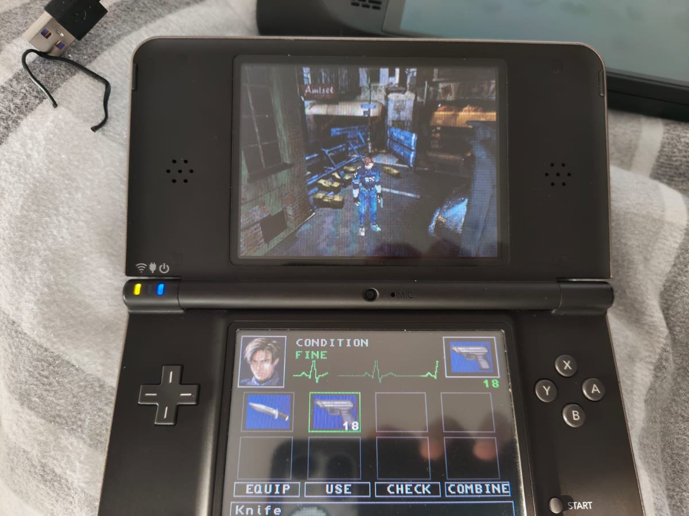

# re2ds – Resident Evil 2 (PS1) on the Nintendo DS

re2ds is a native Nintendo DS engine for **Resident Evil 2** (PS1, PAL disc 1, Leon,
SLES-00972). It is not an emulator: converters turn the data of *your own* disc into DS
formats, and a C engine (devkitARM + libnds) plays them with the game's original rules,
reverse engineered from the PS1 executable.



*Running on real hardware (Nintendo DSi XL).*

> **No game data is included, and none may be shared.** Everything under `build/` and
> `nitrofiles/` and the ROM `re2ds.nds` contain Capcom's data: they are generated locally
> from your own disc, are ignored by git, and must never be committed or distributed.

## Status

Playable from the opening movie through Leon's disc 1 rooms:

- **World:** all 125 rooms of disc 1 – pre-rendered backgrounds with depth masks, camera
  switches, collision, floors / stairs / slopes, doors with their 3D door animations, locks
  and keys, room objects (items lying around, gates).
- **Leon:** tank controls, walk / run / turn with the original turn rates and health
  animations, pose blending, climbing / jumping down, aiming with auto-aim (standing enemies
  before those on the ground), firing with muzzle flash and casings, reloading, the empty
  click, the knife.
- **Enemies:** zombies with the original AI (lurking, chasing over path zones, grab and bite,
  struggling free, hit reactions, falling, dying, eating), people moved by the room scripts
  (Kendo).
- **Scripts:** a SCD bytecode interpreter covering every opcode used on disc 1: flags,
  threads, AOTs, items, messages, cutscenes (`plc_*`), camera cuts, voices, effects.
- **Status screen** on the lower screen: inventory, equip, check with the item pictures,
  combine (loading weapons, mixing herbs), menu sounds.
- **Sound:** sound effects per room, footsteps, music (the PS1 sequences on a DS sequencer),
  voice clips (XA) for all stages, the opening movies with sound.
- **Effects:** blood, muzzle fire, smoke, fires, glass shards (the PS1's ESP sprites with
  their real palettes).
- **Death:** the PS1's death sequence (white flash, circling camera, YOU DIED).
- **Saving:** at the typewriters with an ink ribbon, 12 slots in `re2ds.sav` on the SD card;
  NEW GAME / LOAD GAME at the start and after dying.

Still missing (see [ROADMAP.md](ROADMAP.md)): the item box, the map and files, the other enemy
types, the remaining movies, Claire's disc.

## Repository layout

| Path | Contents |
|------|----------|
| `source/` | the DS engine (C). `formats.h` describes every DS data format. |
| `tools/` | converters (Python 3, two small C tools) from the PS1 disc to `nitrofiles/` |
| `tools/research/` | reverse engineering helpers: the EXE as an ELF for Ghidra/REA, symbol lists |
| `tests/` | host tests that run the engine's script / enemy / cutscene code on a PC |
| `docs/` | analysis notes of the original engine (addresses, tables, behaviour) |
| `Makefile` | devkitPro ARM9 build with NitroFS |
| `start.command` | builds the ROM and starts it in melonDS (macOS) |

Main engine modules:

| File | Role |
|------|------|
| `main.c` | game loop, rooms, cameras, Leon, rendering, weapons, death sequence |
| `script.c` | the room script interpreter (SCD), flags, AOTs, inventory |
| `enemy.c` | zombies and people, path zones, grabbing, hits |
| `plc.c` | characters moved by the scripts (cutscenes) |
| `door.c` | door animations (DO2 programs) |
| `menu.c` | the status screen on the lower screen |
| `effect.c`, `roomfx.c` | blood and casings; ESP effects of the core and the rooms |
| `sound.c`, `music.c` | sound banks, voices, the music sequencer |
| `movie.c` | movie player (FMV) |
| `save.c` | save games on the SD card |
| `assets.c` | file loading from NitroFS |

## Building

### Requirements

- **devkitPro** with devkitARM and libnds (calico) – <https://devkitpro.org/wiki/Getting_Started>
- **Python 3**
- **FFmpeg** (the `ffmpeg` command and its libraries `libavcodec`, `libavutil`, `libswscale`):
  backgrounds and movies are MDEC video. On macOS: `brew install ffmpeg`.
- **clang** or gcc for the two small C tools
- **melonDS** to play (or a flashcart)

`tools/build_assets.sh` and `start.command` assume macOS with Homebrew paths; on Linux adjust
the include / library paths of the `bss2ppm` build line and the melonDS call.

### 1. Extract your disc

You need a raw `MODE2/2352` image of disc 1 (PAL, SLES-00972), e.g. `Track 1.bin` from a
`.bin/.cue` dump of your own disc.

```bash
python3 -I tools/extract_psx_iso.py "Resident Evil 2 (Europe) (Disc 1) (Track 1).bin" build/disc1
```

Files with Form 2 sectors (XA voices, the audio of the movies) are written as raw sectors with
a `.raw2352` suffix; the converters need them like that.

### 2. Convert the data

```bash
tools/build_assets.sh build/disc1
```

This converts every room in parallel and fills `nitrofiles/` (about 290 MB, a few minutes;
the movies take the longest). Single rooms can be converted again with
`tools/convert_room.sh build/disc1 ROOM1010`.

### 3. Build and run

```bash
export DEVKITPRO=/opt/devkitpro DEVKITARM=/opt/devkitpro/devkitARM
make                 # → re2ds.nds
./start.command      # builds if needed and starts melonDS
```

## Controls

| Button | Action |
|--------|--------|
| D-pad | walk / turn (up = forward, down = backward) |
| B | run (hold with up) |
| A | action: doors, items, examine; fire while aiming |
| R | aim (hold); up / down aims high / low |
| START | status screen (inventory); skips the opening movie |
| touch | select on the status screen |

Debug:

| Button | Action |
|--------|--------|
| SELECT | room menu: warp to any room (L/R ±10, A warp) |
| hold SELECT while the game boots | leaves out the opening movie |
| L + A at a door | opens any lock |
| L + A at a typewriter | saves without an ink ribbon |

In melonDS's default keyboard mapping START is Enter and SELECT is Backspace (check
*Config → Input and hotkeys*).

Saving needs an SD card: on a flashcart or a DSi it is the card the ROM runs from
(`fat:/re2ds.sav` or `sd:/re2ds.sav`). In melonDS enable *Config → Emu settings → DLDI →
Enable DLDI (for homebrew)* with an SD card image of **1 GB** and *Sync SD to folder* with the
folder `~/Documents/re2ds-sd`
(or set `RE2DS_SD` to another one). With DLDI on, the DS cannot read the game data from the
cartridge any more and melonDS passes no ROM path, so the game reads `re2ds.nds` from the SD
card root: `start.command` copies it into that folder whenever the ROM changed. melonDS keeps
the ROM there padded to 512 MB, so a 512 MB image leaves no room for `re2ds.sav`.

## Tests

The host tests compile the engine's platform-independent parts for the PC:

```bash
# every room's scripts with stubbed engine hooks; reports unknown opcodes
cc -O1 -g -fsanitize=undefined -Isource tests/script_host.c -o build/script_host
build/script_host nitrofiles/room/room[0-9][0-9a-f][0-9a-f]0.bin

# zombies against a scripted player
cc -Itests/stubs -Isource tests/enemy_host.c source/script.c source/enemy.c source/plc.c -o build/enemy_host -lm
build/enemy_host

# a room event with Leon and the enemies moved by the script (here: Kendo in room 101)
cc -Itests/stubs -Isource tests/cutscene_host.c source/script.c source/enemy.c source/plc.c -o build/cutscene_host -lm
build/cutscene_host nitro:/room/room1010.bin 0x16 1200
```

`tools/scd_disasm.py ROOM1010.RDT` disassembles a room's scripts; `--check` validates the jump
targets of all block opcodes over all rooms.

## How the original works

The engine follows the PS1 code wherever it has been analysed; source comments name the
PS1 functions and tables they reproduce (`FUN_8003ed74`, `0x8009f560`, …). The notes in
[docs/](docs/) collect what is known:

- [player-control.md](docs/player-control.md) – input, the player state machine, turning,
  aiming, firing, reloading
- [enemy-zombie.md](docs/enemy-zombie.md) – the zombie AI
- [enemy-others.md](docs/enemy-others.md) – dog, crow, licker, the enemy load table
- [damage.md](docs/damage.md) – hit checks, damage tables, hit reactions, head shots
- [engine-notes.md](docs/engine-notes.md) – scripts, cutscenes, voices, room objects, effects,
  item pictures, movies, the death sequence

To look at the code yourself, wrap the executable as an ELF (optionally with an overlay such as
the zombie code or `DIEDEMO.BIN`) and open it in Ghidra:

```bash
python3 -I tools/research/psxexe_to_elf.py build/disc1/SLES_009.72 sles.elf tools/research/re2_symbols.txt
```

### Conventions

- World coordinates are RE2 game units, used directly as DS 20.12 fixed point
  (4096 units = 1.0); −Y is up.
- Angles: RE2 uses 4096 per turn, the DS engine 32768 (× 8).
- Models face +X; the model matrix is `T(pos) · Ry(dir)`, bones `M_parent · T(pos) · Rx · Ry · Rz`.
- The PAL game logic runs at 25 Hz (`VSync(2)` at 50 Hz); the DS engine steps the game logic
  at that rate and turns per DS frame scaled to it.
- Camera: `lookAt(from, to)` with up = −Y, projected onto 320 × 240 at distance
  `RID.distance >> 7`, scaled by 0.8 for 256 × 192.

## Contributing

- Keep the engine faithful to the original: when something is ported, say in a comment which
  PS1 function or table it comes from, and mark guesses as such.
- Write code and comments in English and match the style of the surrounding code.
- Run the host tests before sending changes; they need your own converted data.
- Never commit anything generated from the disc (`build/`, `nitrofiles/`, `*.nds`).

Built on the file format work of [OpenBiohazard2](https://github.com/OpenBiohazard2/OpenBiohazard2)
(a Go reimplementation of the PC version), whose script opcode table and readers were the
starting point for several converters.
