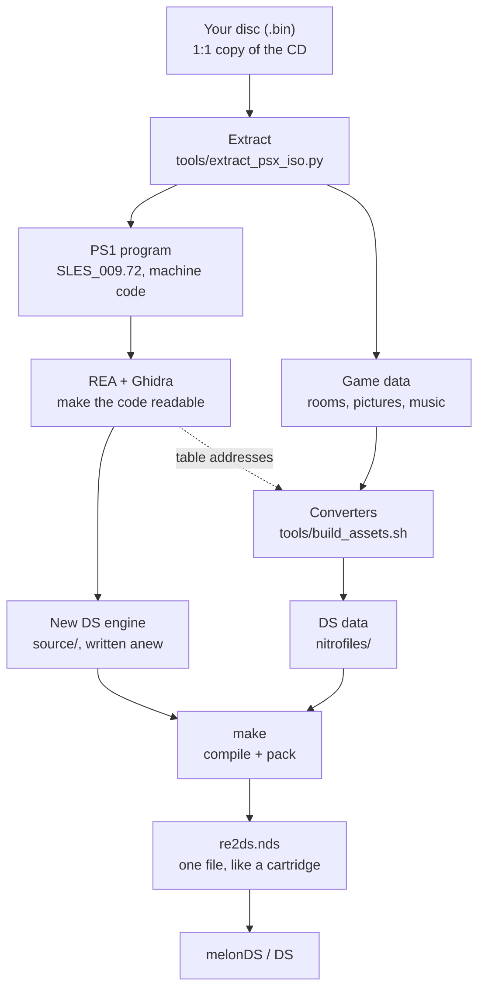

# How re2ds works – from the disc image to the DS ROM

A plain-language overview for anyone who wants to understand the project before reading
the code. The other files in `docs/` go into the details of the original engine.

## The idea

A PlayStation game has two parts:

- **the program** (the "engine"): how Leon walks, how zombies attack, how doors work;
- **the data**: rooms, background pictures, 3D models, music, movies, texts.

The DS cannot run the PS1 program: it has a different processor (ARM instead of MIPS),
different graphics hardware and different sound. So re2ds is **not an emulator**. The
**engine is written anew** for the DS (`source/`), and the **data comes from your own disc**
and is only converted (`tools/`).



## Step by step

1. **The `.bin` is a 1:1 copy of the CD.** Like a ZIP file it holds many files.
2. **Extracting** (`tools/extract_psx_iso.py`) gets them out: the PS1 program
   (`SLES_009.72`), 125 rooms, the backgrounds, the models, music, voices and movies.
   Sectors with sound (XA voices, movie audio) are kept as raw sectors (`.raw2352`).
3. **Understanding how the original works** – the bulk of the work. The PS1 program is read
   with REA and Ghidra (below): how is a wall checked, when does a zombie grab, when does the
   camera switch? Every rule is written down in `docs/` and programmed anew for the DS in
   `source/`. No PS1 code is copied; it could not run on the DS anyway.
4. **Converting the data** (`tools/build_assets.sh`): one small converter per kind of data
   (next section). The results go to `nitrofiles/`.
5. **Building the ROM** (`make`): the compiler turns the engine into ARM code for the DS and
   packs it with `nitrofiles/` into **one file**, `re2ds.nds`.
6. **Playing**: melonDS (or a flashcart on a real DS) starts the `.nds`. The engine loads only
   the current room from it – the DS has just 4 MB of main memory.

Because the converted rooms keep the **original room scripts** and the new engine runs them
like the PS1 does, doors, puzzles and events behave as in the original.

## What REA and Ghidra do

The PS1 program is **machine code**: about 600 KB of numbers that only the PS1 processor
understands, without source code, comments or function names.

```
27 BD FF E8 AF BF 00 10 0C 01 23 45 ...
```

**Ghidra** (a free reverse-engineering tool) translates this step by step into something
readable: first into assembler (single processor instructions: load, add, jump), then into
**pseudo C** – roughly what a programmer might have written. Functions are only named after
their address, e.g. `FUN_8002bc00`; what they do has to be worked out.

**REA** is the tool that drives Ghidra for Claude: "decompile this function", "who reads or
writes this address?" – and returns the answers as text.

How it is used:

1. **Make the program loadable.** Ghidra does not know the PS1 executable format.
   `tools/research/psxexe_to_elf.py` wraps it in a standard ELF file and states the address the
   PS1 loads it to; otherwise every address would be wrong.
2. **Read and understand functions** in pseudo C. Findings get names in
   `tools/research/re2_symbols.txt` and explanations in `docs/`.
3. **Follow cross references.** The key question is often "who uses this address?" – from
   something known to something unknown.
4. **Write the rule anew for the DS** in our own C code.

### Example: the item box seen through a wall

1. In room 208's darkroom camera the item box of the next room showed through the wall.
2. Known: the room objects live in PS1 memory from `0x800c7f20` on.
3. REA: "who accesses `0x800c7f20`?" – about 60 places. One is a loop over all objects,
   `FUN_80033f70`, and it draws them.
4. In that loop: draw an object only if `FUN_8002bc00(...)` says yes.
5. REA: show that function – it checks whether a point lies in a quad on the floor.
6. REA: where does the quad come from? – the **view area of the current camera** (the first
   camera switch zone of that camera, `FUN_8002bbbc`).
7. Result: the PS1 draws an object only while it stands in the active camera's area. The DS
   engine does the same now (`in_view_area` in `source/main.c`).

The music control (`FUN_8005702c`), the room music table (`FUN_80057330`), the collision
(`FUN_80048964`), the zombie AI, damage, Leon's controls and the meaning of every script
opcode were worked out the same way.

### Data inside the program

The data files' formats are mostly known (from OpenBiohazard2 and other projects). REA is
needed where data sits **inside the program itself**: item names, the room → music table,
the list of movies, the enemy model table. Their addresses were found with REA, and the
converters read them there – which is why only the European English disc (SLES-00972)
works: in other versions (e.g. the US one, SLUS-00421) these tables are at other addresses.

## The converters in `tools/`

Every converter does the same three things:

1. **read the PS1 file** – just bytes; the converter knows where what is ("bytes 4–7 = number
   of cameras");
2. **rebuild it** in a form the DS hardware can use directly (other picture size, colour depth,
   sound format);
3. **write the DS file** to `nitrofiles/`. Every format is defined in `source/formats.h`, so
   engine and converters speak the same language.

### Example: a background picture

1. **`bss2ppm` (C):** the PS1 stores every camera picture as a single video frame (MDEC,
   similar to a JPEG); FFmpeg decodes it into a normal 320×240 picture.
2. **`bg2ds.py`:** scales it to **256×192** (the DS screen) and reduces it to **255 colours**
   with dithering (a DS bitmap background has 256 colours).
3. **`lz77`:** compresses it in the format the DS BIOS unpacks by itself.

`bssmask.py` and `mask2ds.py` add the **masks**: parts of the picture such as a table edge that
must be drawn in front of Leon so he disappears behind the table.

### All converters

| Data | Converter | What happens |
|---|---|---|
| Disc | `extract_psx_iso.py` | files out of the `.bin`; sound sectors stay raw |
| Rooms | `rdt2json.py` → `room2ds.py` | cameras, walls, floors, camera zones, doors, texts and **scripts** into one DS room file |
| Backgrounds | `bss2ppm`, `bg2ds.py` | as above |
| Masks | `bssmask.py`, `mask2ds.py` | foreground parts as flat 3D quads at the right depth |
| Leon | `pld2json.py`, `model2ds.py`, `plw2ds.py` | 3D model, bones, animations; one model per weapon |
| Enemies | `em2ds.py` | zombies etc.; where they lie on the disc comes from a table in the PS1 program |
| Room objects | `obj2ds.py`, `rbj2ds.py` | items, typewriter, item box, the room's animations |
| Doors | `do2ds.py` | door model, door animation, door sound |
| Zombie paths | `blk2ds.py` | copied unchanged |
| Sounds | `vab2ds.py`, `enemse2ds.py` | PS1 ADPCM (4 bit) into DS sound |
| Music | `bgm2ds.py` | notes stay, instruments become 8-bit samples; plus the room → music table |
| Voices | `xa2ds.py` | XA audio into DS sound |
| Movies | `str2ds.py` | FFmpeg decodes the video; 256×128 frames at 15 fps plus the sound |
| Inventory | `menu2ds.py`, `itps2ds.py` | item icons, item pictures and names (from the PS1 program) |
| Effects | `esp2ds.py`, `resp2ds.py` | blood, sparks, smoke, casings |
| "YOU DIED" | `die2ds.py` | the picture when Leon dies |

### Who runs them

- **`build_assets.sh`** runs every converter in the right order, using all processor cores, and
  copies the result to `nitrofiles/`.
- **`convert_room.sh`** converts one room; `build_assets.sh` starts it for all 125 rooms in
  parallel.
- `make` then builds the ROM; it notices changed files in `nitrofiles/` by itself.

### Helpers that convert nothing

- `ds_preview.py`, `preview_model.py`, `door_preview.py`: preview pictures on the PC, to check
  a conversion.
- `check_projection.py`: draws the walls into a camera picture, to check the camera maths.
- `reachability.py`: checks that every door of a room can be reached.
- `scd_disasm.py`: shows the room scripts in readable form.
